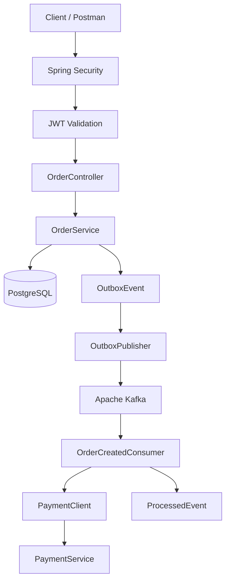
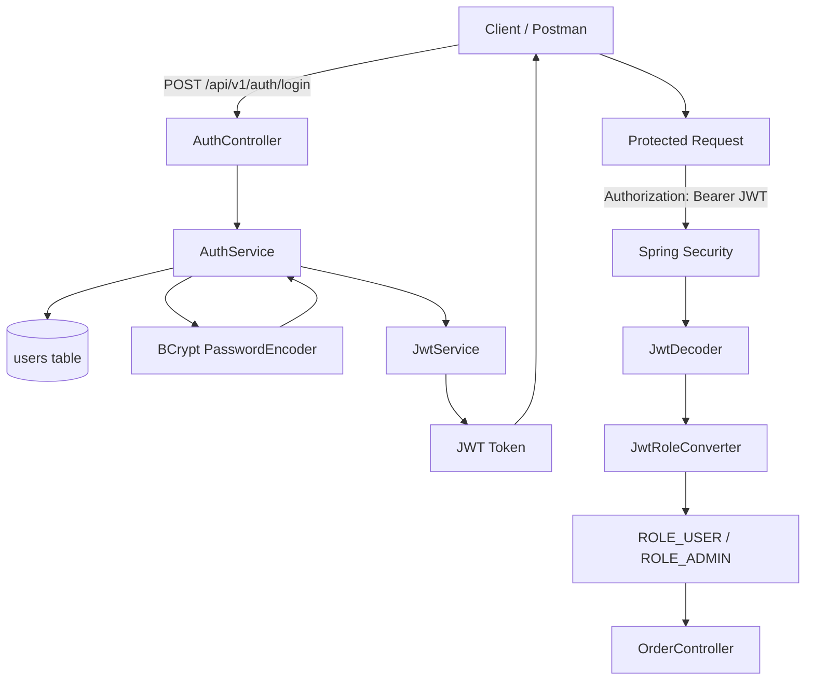
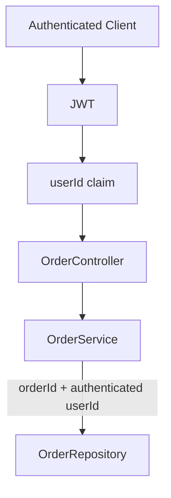

# Order Service Architecture

## 1. Arquitectura general

El siguiente diagrama representa los principales componentes del servicio y el flujo asíncrono de procesamiento de órdenes.



## 2. Autenticación y autorización JWT

La aplicación utiliza JWT para autenticar usuarios y proteger los endpoints privados.

El flujo se divide en dos etapas:

- autenticación, donde el usuario obtiene un token;
- autorización, donde Spring Security valida el JWT en cada request protegida.



### Claims principales del JWT

El token contiene información utilizada para identificar al usuario autenticado.

```text
sub
userId
role
iss
iat
exp
```

Ejemplo conceptual:

```json
{
  "sub": "user@test.com",
  "userId": 2,
  "role": "USER",
  "iss": "order-service"
}
```

### Roles

Los roles utilizados actualmente son:

```text
USER
ADMIN
```

El claim `role` se convierte en una authority de Spring Security.

```text
USER
-> ROLE_USER

ADMIN
-> ROLE_ADMIN
```

Esto permite utilizar controles como:

```java
@PreAuthorize("hasRole('ADMIN')")
```

### Protección BOLA / IDOR

El `userId` utilizado por el backend no se recibe directamente desde el cliente.

Se obtiene desde el JWT validado.



Para usuarios normales, la consulta se realiza utilizando ownership:

```java
findByIdAndUserId(orderId, authenticatedUserId)
```

Esto evita que un usuario pueda acceder a una orden perteneciente a otro usuario simplemente modificando el identificador de la URL.

Un usuario con rol `ADMIN` puede consultar órdenes sin aplicar esta restricción de ownership.